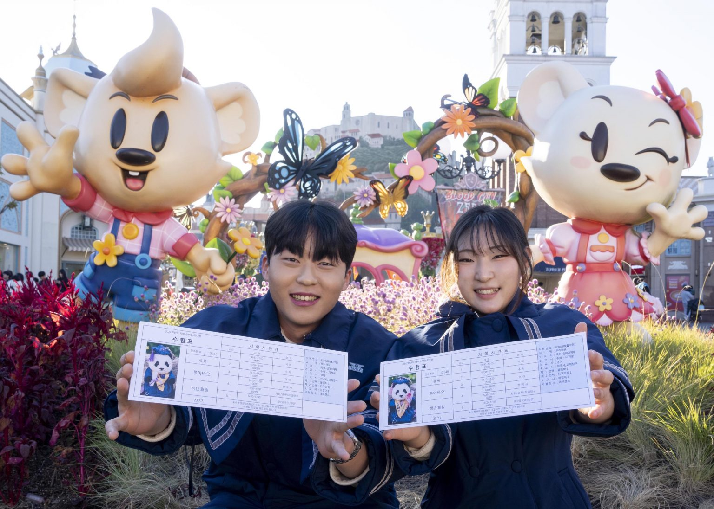

# 수능 수험표로 무료·반값 되는 정원 7곳

천리포수목원·휴애리는 본인 무료, 순천만국가정원은 순천 고교 응시자만. 가장 먼저 끝나는 곳은 11월 30일

[초안 · 편집자 검수 전]

> **편집자의 정원 노트** — 소설을 이틀 지나 중부 지방 정원은 잎을 거의 다 떨궜고 남해안과 제주에서는 동백이 첫 꽃을 열고 있다. 오늘은 수능을 마친 수험생이 수험표 한 장으로 들어갈 수 있는 수목원과 정원을 짚는다.

소설이 지난 11월 하순은 바깥 정원이 한 해 중 가장 비어 보이는 때다. 그래도 문을 닫는 곳은 드물다. 2027학년도 대학수학능력시험(11월 19일 시행)이 끝난 뒤 전국 수목원·식물원·정원 일곱 곳이 수험생 관람료 우대를 내놓았다. 본인 무료가 세 곳이고 반값 안팎 할인이 네 곳이다.

시기가 겹치는 데는 이유가 있다. 초겨울 정원에서는 온실 속 열대식물과 상록수, 동백 같은 겨울 꽃이 볼거리를 맡는데, 수험생 혜택도 대부분 12월 31일에 끝난다. 다만 조건은 제각각이다. 지역 학생만 받는 곳이 있고 사전 예매를 거쳐야 하는 곳도 있다. 가장 먼저 마감하는 대전 오월드는 11월 30일까지만 받는다.

*순천만국가정원의 호수정원. 찰스 젱크스가 순천을 둘러싼 산과 물길을 본떠 설계했다. 순천 지역 수험생은 12월 31일까지 무료로 들어갈 수 있다. [사진 출처 확인]*

## 본인 무료 세 곳, 그중 한 곳은 지역 제한

충남 태안 천리포수목원은 12월 31일까지 수험생 본인에게 입장료를 받지 않는다. 정상가는 1만1000원(청소년 8000원)이다. 2027학년도 수능 수험표 원본이나 2008년생임을 확인할 수 있는 신분증·학생증을 내면 된다. [확인 필요: 올해 공지 미확인. 2024년은 수험생 본인 12월 31일까지, 지난해는 19세 청소년 11월 30일까지였다. 기간·대상·정상가를 수목원에 직접 확인] 지금 밀러가든 산책로에서는 호랑가시나무류가 붉은 열매를 달고 있고 목련은 털에 싸인 겨울눈을 단 채 겨울을 난다. 이 수목원이 오래 모아 온 두 수종이 잎 없는 계절에 오히려 잘 보인다.

제주 서귀포 휴애리 자연생활공원은 기간이 가장 길다. 내년 1월 31일까지 수험생 본인은 무료다. 야외에서는 동백과 유채꽃을 보고 온실에서는 계절과 상관없이 수국을 볼 수 있다. 매표소에서 수험표 실물을 직접 확인하므로 휴대전화 사진이나 복사본으로는 들어갈 수 없다. [확인 필요: 휴애리 수험생 행사는 보도·공식 채널에서 찾지 못함. 064-732-2114로 기간과 조건 확인, 확인 안 되면 이 문단 삭제]

전남 순천시는 11월 20일부터 12월 31일까지 순천만국가정원, 순천만습지, 낙안읍성, 뿌리깊은나무박물관, 드라마촬영장 5곳을 수험생에게 무료로 연다. 대상은 순천시 소재 고등학교 재학생과 졸업생 가운데 2027학년도 수능 응시자로 한정된다. 고3 담임교사가 인솔하는 단체는 수험표 확인을 생략한다. 다른 지역 수험생은 일반 요금을 내야 하니 먼 길을 나서기 전에 이 조건부터 확인하는 편이 낫다.

## 반값 안팎 네 곳, 온실과 야간 정원

대구 달성 네이처파크는 11월 19일부터 12월 20일까지 '고생했어, 수험생 할인'을 진행한다. 수험생 본인 입장권은 1만 원으로 정상가 2만 원의 절반이다. [확인 필요: 행사명·기간은 공식 페이지에서 확인, 할인 금액은 미확인] 약 40만㎡(12만 평) 부지 가운데 있는 대형 유리온실 '글라스하우스'에서 열대식물과 관엽식물을 추위 걱정 없이 본다. 매주 화요일은 쉰다.

경남 통영 디피랑은 밤에 가는 정원이다. 남망산조각공원 숲길을 따라 미디어아트와 조명을 설치한 디지털 정원 테마파크다. 운영사인 통영관광개발공사가 11월 19일부터 내년 1월 31일까지 수험표를 지참한 수험생에게 이용료를 절반으로 받는다. 통영케이블카와 어드벤처타워도 같은 조건이다.

테마파크 두 곳도 정원을 끼고 할인한다. 대전 오월드는 11월 19일부터 30일까지 수험생에게 청소년 자유이용권을 정상가 2만8000원의 절반인 1만4000원에 판다. 현장 매표소에서 수험표와 신분증을 확인한다. 10만㎡ 규모 '플라워랜드'와 동물원을 함께 쓰는 표다. 경기 용인 에버랜드는 12월 31일까지 수험생 본인 이용권을 2만 원에 내놓았고 동반자는 3명까지 1인당 3만 원이다. [확인 필요: 정상가 6만5000원은 미확인이라 뺌] 스마트예약으로 방문을 신청한 뒤 현장에서 수능 수험표나 수시 합격증, 신분증을 확인받는 방식이라 예약 없이 가면 혜택을 받지 못한다.

*에버랜드가 수험생 할인을 알리며 공개한 사진. 수험표 모양 소품에 쌍둥이 판다 루이바오·후이바오가 들어갔다. 뒤 화단에는 천일홍과 그라스류가 심겨 있다. [사진 출처 확인]*

## 수험표 할인이 없는 곳에서 쓸 수 있는 요금

이름난 수목원이라고 모두 수험생 할인을 하지는 않는다. 한국수목원정원관리원이 운영하는 국립세종수목원·국립백두대간수목원·국립한국자생식물원과 포천 국립수목원, 서울식물원, 아침고요수목원, 화담숲에는 수험표 우대가 없다.

대신 쓸 만한 요금이 있다. 국립세종수목원과 국립백두대간수목원은 매달 마지막 수요일 '문화가 있는 날'에 모든 관람객을 무료로 들인다. 이번 달은 내일인 11월 25일이고 다음은 12월 30일이다. 서울식물원(온실 3500원, 야외 무료)과 포천 국립수목원(700원, 차량은 사전 예약)은 만 18세까지 청소년 요금을 받으니 고3 수험생은 대부분 이 요금으로 들어간다. [확인 필요: 서울식물원 온실 청소년 요금]

경북 경주 동궁원의 복합문화정원 '라원'은 수험생 전용 할인은 없지만 12월 1일부터 31일까지 누구나 쓸 수 있는 할인을 연다. SNS에 응원 메시지나 관람 후기를 올려 인증하면 성인 정상가 1만6000원인 입장권을 7000원에 산다. 할인권은 온라인에서만 팔고 인증자를 포함해 4명까지 적용된다.

## 집을 나서기 전 확인할 세 가지

모든 시설이 2027학년도 수능 수험표 실물 원본과 사진이 붙은 신분증(주민등록증·청소년증·학생증·여권)을 함께 확인하는 것을 원칙으로 한다. 둘 중 하나만 들고 가면 매표소에서 막힐 수 있다.

온라인에 아직 떠도는 '2026학년도 수능 할인' 안내문은 지난해 끝난 행사다. 공지 날짜가 올해 11월 19일 이후인지, 문구에 '2027학년도'가 들어 있는지 본다.

동절기인 11~12월에는 대부분 오후 4시에 입장을 마감하고 5시에 문을 닫는다. 점심 무렵 출발해서는 정원 한 곳을 다 돌기 어렵다.

일정을 짠다면 11월 30일에 끝나는 대전 오월드와 내일 무료로 열리는 국립세종·백두대간수목원부터 달력에 넣는다. 나머지는 12월 31일이나 내년 1월 31일까지 여유가 있다. 출발 전날 시설 공지에서 휴장일과 '2027학년도' 문구를 한 번 더 확인하면 헛걸음을 막을 수 있다.

---

### 2027학년도 수능 수험생 정원·식물원 관람료 우대 (마감 순)

**혜택 조건은 시설 사정에 따라 바뀔 수 있다 · 방문 전 각 시설 공지 확인**

| 마감 | 지역 | 시설 | 수험생 요금 (정상가) | 조건 |
|---|---|---|---|---|
| 11.30(월) | 대전 | 오월드 (플라워랜드) | 청소년 자유이용권 1만4000원 (2만8000원) | 현장 매표소에서 수험표·신분증 |
| 12.20(일) | 대구 달성 | 네이처파크 | 1만 원 (2만 원) [금액 확인 필요] | 본인 한정, 매주 화요일 휴장 |
| 12.31(목) | 충남 태안 | 천리포수목원 [올해 공지 확인 필요] | 무료 (1만1000원, 청소년 8000원) | 수험표 원본 또는 2008년생 신분증·학생증 |
| 12.31(목) | 경기 용인 | 에버랜드 (포시즌스가든) | 이용권 2만 원, 동반 3인 각 3만 원 | 스마트예약 후 현장에서 수험표·수시 합격증·신분증 |
| 12.31(목) | 전남 순천 | 순천만국가정원·순천만습지·낙안읍성 등 5곳 | 무료 | 순천시 소재 고교 재학·졸업 응시자만 |
| 27.1.31(일) | 제주 서귀포 | 휴애리 자연생활공원 [행사 확인 필요] | 무료 | 수험표 실물 필수 (사진·복사본 불가) |
| 27.1.31(일) | 경남 통영 | 디피랑 | 50% 할인 | 수험표 지참, 야간 운영 |

**수험표 할인 없음, 대신 쓸 수 있는 요금**

| 시설 | 요금 |
|---|---|
| 국립세종수목원·국립백두대간수목원 | 문화가 있는 날(11월 25일, 12월 30일) 전원 무료 |
| 서울식물원 | 만 18세까지 청소년 요금 (온실 3500원, 야외 무료) |
| 포천 국립수목원 | 만 18세까지 청소년 요금 700원, 차량 사전 예약 |
| 경주 동궁원 '라원' | 12월 1~31일 SNS 인증 시 7000원 (1만6000원), 온라인 판매, 4명까지 |

---

### 발행 전날 티저

> 내일 아침, 소설 무렵 정원 이야기를 준비하고 있습니다. 수험표 한 장으로 문이 열리는 정원이 있고 같은 수험표를 내밀어도 일반 요금을 받는 정원이 있습니다.
